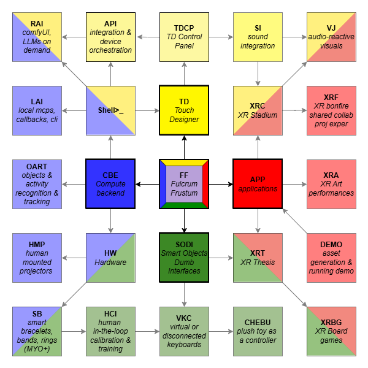

# FF — Fulcrum Frustum

*Shared Light: A Framework for Collaborative Projective XR*

FF is two things:

- **A conceptual framework**: a way to give many independent devices —
  cameras, projectors, phones, wearables, sensors — one shared spatial and computational
  reference, so art or any content can be attached to a room or to moving objects and
  light can be rendered from whichever device is available.
- **A physical calibration object**: the Fulcrum Frustum itself, a small
  measured, marker-covered truncated pyramid that acts as a common ruler
  that cameras can observe and projectors can be registered against
  through camera measurements.


## The framework



The framework has **exactly four categories**, shown as element colors in
the overview. The elements are just creative organizational metaphors.

| Category | Element | Glyph | Role |
|----------|---------|-------|------|
| **SODI** | GREEN EARTH | 🟩 | Smart Objects / Dumb Interfaces — physical objects, embodied interfaces|
| **TD** | YELLOW LIGHT | 🟨 | TouchDesigner — projective mapping, animations, and show rendering |
| **CBE** | BLUE COMPUTE / AIR | 🟦 | Compute Backend — calibration, CV, tracking, services |
| **APP** | RED FIRE | 🟥 | Applications — experiences, demos, artworks |

Reading the diagram:

- A **diagonally split square** means an **intersection of categories** —

- **Arrows** mean connection/dependency.
- The **FF itself sits at the center and touches all four categories**:
  it is a physical artifact (SODI), a measured geometry (CBE), a tracking
  and rendering subject (TD), and a thing people interact with (APP).

## Project codes

Codes let us discuss work across category lines without re-litigating
taxonomy. All labels below describe **framework scope, not implementation
status**. Intersections are shared responsibilities: pick a canonical
owning location and reference it rather than duplicating folders.

| Code | Categories | Description |
|------|-----------|-------------|
| **FF** | all four | The framework and its physical calibration reference; shared spatial language across all four categories |
| **Shell>_** | CBE+TD | Shell / command interface overseeing devices, calibrations, and workflows |
| **RAI** | CBE | Remote AI: ComfyUI / LLMs on demand |
| **LAI** | CBE | Local AI: MCPs, callbacks, and CLI |
| **API** | CBE | Integration and device orchestration scripts|
| **TDCP** | TD | TD Control Panel, config sitting inside TD with previews and controls|
| **SI** | TD | Sound integration |
| **VJ** | TD+APP | Audio-reactive visuals |
| **OART** | CBE | Objects and activity recognition and tracking |
| **HMP** | CBE | Human mounted projectors hardware subproject |
| **HW** | CBE+SODI | Hardware category |
| **SB** | CBE | Smart bracelets, bands and rings (Myo+) |
| **HCI** | SODI | Human-in-the-loop calibration and training |
| **VKC** | SODI | Virtual or disconnected keyboards (and controllers). Conceptually relies on sEMG recognition and visual hand tracking |
| **CHEBU** | SODI | Cheburashka plush toy as a controller subproject |
| **XRC** | TD+APP | XR Stadium subproject. Watching (e)sports together on a shared canvas|
| **XRF** | APP | XR Bonfire / shared collaborative projection. Relies on smoky environment (smoke machine or shisha) and multiple projective devices |
| **XRA** | APP | XR art performances |
| **XRT** | SODI+APP | XR Thesis. Tracking of a little black book, tracking hands via MediaPipe, projected visuals and texts complimenting the content of the book |
| **DEMO** | APP | Asset generation and running demos. Includes scripts for blender integration, concat video editor and a gallery of produced artifacts |
| **XRBG** | SODI+APP | XR Board Games |


## Repository layout (what exists today)

```
ff
├── FF_Overview.png            # framework diagram
├── APP/
│   ├── DEMO/
│   │   ├── blender_integration/
│   │   └── concat_integration/
│   │   └── gallery/
│   └── XRT/
├── CBE/
│   ├── OART/
│   └── shell/
├── SODI/                      
└── TD/
|    └── connected_aligned.toe  # main TouchDesigner project (connecting inputs, TDCP v1, tracking ff v1, animations)
└── docs/                      
|    └── shared_projective_xr.pdf  # main document
```
## Evidence vs. plan


| Status | Item | Where today |
|--------|------|-------------|
| Available code | ArUco-marked FF geometry spec; webcam + projector + Kinect calibration solver (`ff_calibrate.py`); live FF tracking prototypes | ProjectSynchronicity `tools/fulcrum/` |
| Available code | Isolated tracking worker and TD live-visualization modules (`ff_worker.py`, `td_ff_live.py`, `td_ffv2_live.py`) | ProjectSynchronicity `tools/td/` |
| Experimental | Myo armband → Web Bluetooth → TD input path (`myo/`) | same repo |
| Experimental | Audio-reactive browser/TD studies (Synchronicity app) | same repo |
| Experimental | Cheburashka anamorphic visual demo | same repo |


## Quick reference

Python environment:
```powershell
C:\Python314\python.exe (cv2/numpy/SciPy)
```

Calibration script:
```powershell
C:\Python314\python.exe ff_calibrate.py --help
```

Optional read-only bridge ping (requires the TD bridge already running
per `tools/td/README.md`):
```powershell
'{"op":"ping"}' | node tools/td/td.mjs --json -
```

Connect to projector
```powershell
adb connect 192.168.0.170:5555
```

Reset projector
```powershell
adb shell am force-stop com.fengmi.projector.imaging
```

Focus projector
```powershell
adb shell am start -a com.fengmi.projector.imaging.action.START_FOCUS
```

Switch to hdmi
```powershell
adb shell am start -a android.intent.action.VIEW -d "content://android.media.tv/passthrough/com.droidlogic.tvinput%2F.services.Hdmi1InputService%2FHW5" -n com.android.tv/.MainActivity
```

Make a screenshot from the proj embedded camera
```powershell
python tools/projector/projctl.py cam_shot .\cam_shot.jpg
```


## The Plan

| ID | Code(s) | Seed |
|----|---------|------|
| **OART-01** | CBE | Existing calibration pipeline cleanup|
| **TDCP-01** | TD | Fix and improve TD control panel |
| **SHELL-01** | SHELL | Hierarchical cli for controlling the projector and checking status of td-bridge |
| **XRT-01** | XRT | Measured specifications for the Thesis, aruco codes on pages of interest, some supplimentary materials |


## Documents

- [`_docs/shared_projective_xr.pdf`](_docs/shared_projective_xr.pdf) —
  illustrated audited design.
- [`_docs/shared_projective_xr.tex`](_docs/shared_projective_xr.tex) —
  self-contained LaTeX source.


## Contributing

Reduce, reuse, recycle!